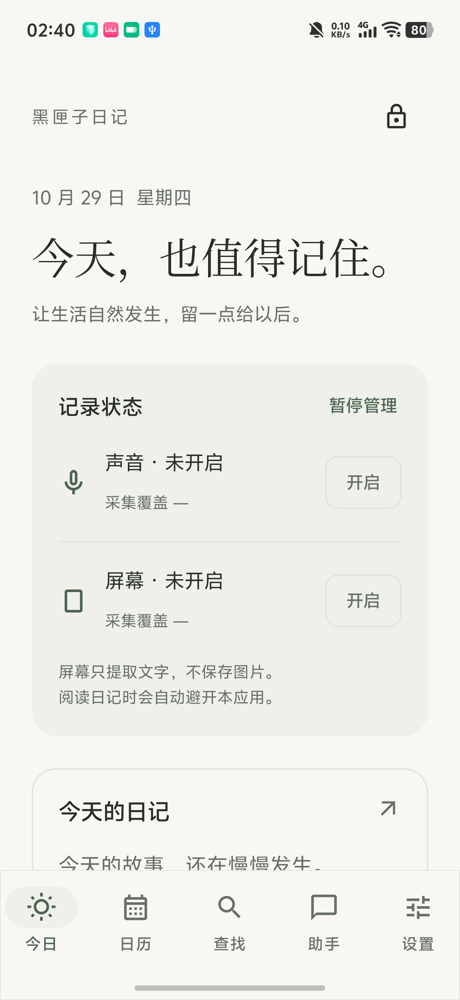
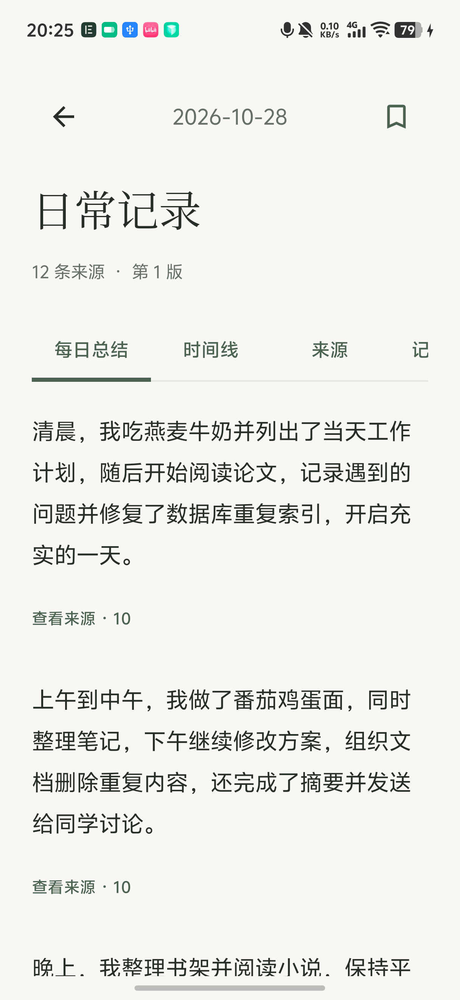
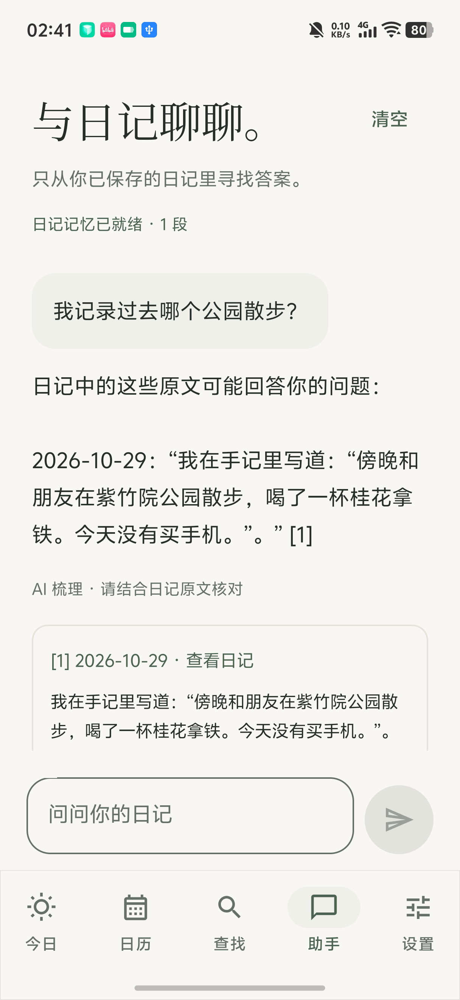
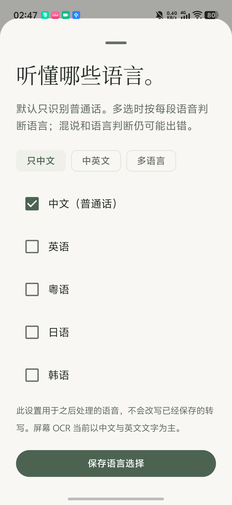
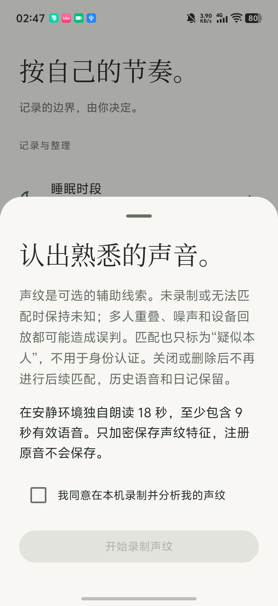
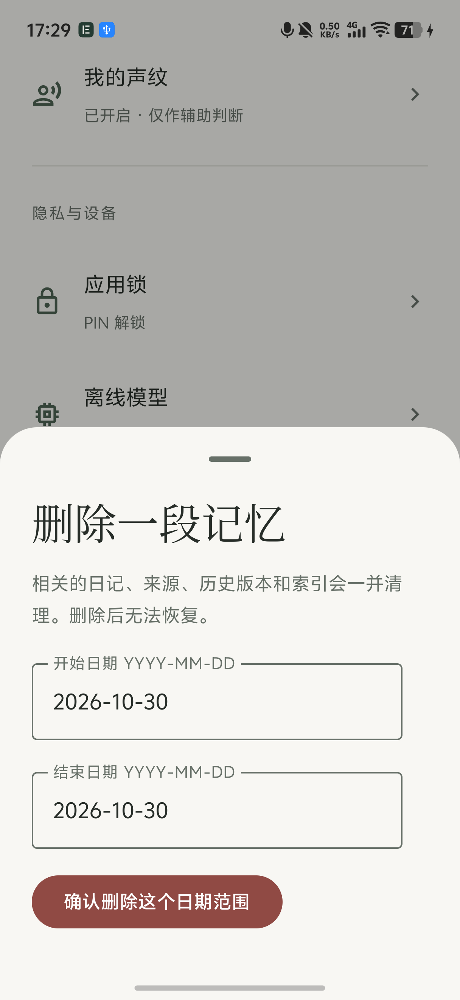
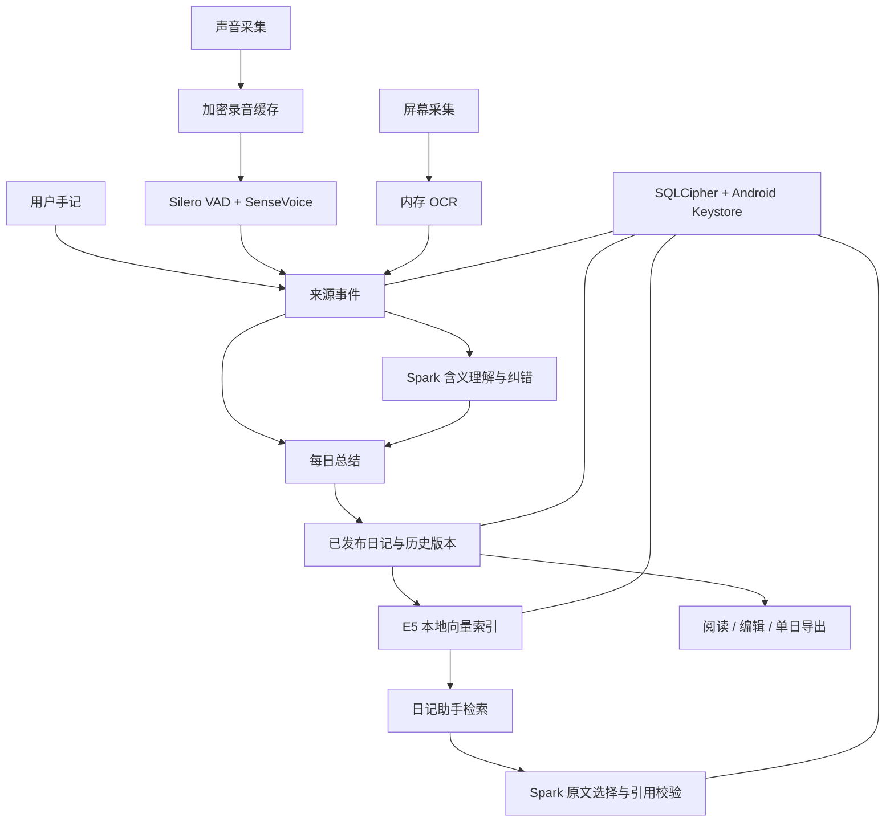

# 黑匣子日记

**在手机本地，把当天的记录整理成日记。**

黑匣子日记是一款原生 Android 应用。开启声音或屏幕采集后，它在手机上完成语音识别、文字提取、语义整理和每日总结。用户可以编辑日记、查看原始转写，也可以向日记助手提问，找回自己记录过的信息。

日记往往包含工作讨论、个人安排和身边人的声音。黑匣子日记使用 **Spark-X2.5-4B 端侧模型**处理这些内容，正文、录音缓存、记忆向量和对话保存在本机加密存储中。应用运行时无需账号、云端接口或 API Key，Android 应用清单移除了网络权限。

[下载安装包](https://github.com/Karl-XZ/blackbox-diary/releases/tag/v1.3.2) · [构建与测试](#从源码构建) · [模型准备](docs/models.md) · [技术架构](docs/architecture.md) · [测试说明](docs/testing.md)

| 当前版本 | 系统要求 | 主要推理路径 | 开发者 |
| --- | --- | --- | --- |
| 1.3.2-daily-summary | Android 14 / API 34 及以上 | Spark-X2.5-4B GGUF + llama.cpp / SME2 CPU | 周昊洋（Karl-XZ） |

## 应用界面

以下为 vivo V2509A / Android 16 上的应用截图。每日总结图使用自动化测试录入的 12 条合成记录；助手图使用预置手记演示检索与引用。删除记忆图摄于当前应用的实际操作页面。

<table>
  <tr>
    <td align="center"><br>今日与采集状态</td>
    <td align="center"><br>每日总结（合成测试记录）</td>
    <td align="center"><br>日记助手（预置手记）</td>
  </tr>
  <tr>
    <td align="center"><br>识别语言设置</td>
    <td align="center"><br>可选声纹</td>
    <td align="center"><br>按日期删除记忆</td>
  </tr>
</table>

[查看截图来源与原图](docs/screenshots/README.md)

## 解决什么问题

**想记录生活，却很难每天坚持写。** 学习、工作和出行中的信息分散在口头交流、手机页面和临时手记里。到了晚上，重新回忆和整理需要额外时间。应用按日期汇集获准采集的材料，生成可阅读、可修改的日记。

**日常记录涉及隐私。** 长时间录音和屏幕文字可能涉及个人安排、聊天和工作内容。端侧识别与生成让处理留在手机内，用户自行决定采集来源、暂停时间和保留期限。

**留下记录之后，还要能找得到。** 用户可以按日期、关键词和来源查找，也可以直接问日记助手。助手从已发布的日记中检索，回答附带日期和原文引用，点击即可回到相关日记。

主要面向有日常复盘需求的学生、研究者、开发者和知识工作者，以及希望保留生活记录、重视个人数据管理的用户。

## 核心功能

| 功能 | 使用方式与行为 |
| --- | --- |
| 每日总结 | 默认计划在每天 02:00 整理前一天；也可在今日页手动生成。材料先提炼主题要点，再合并去重、形成段落，正文与来源分开展示。 |
| 自动理解语音 | 保留原始 ASR，结合邻近记录分析有效含义，修正可推断的识别错误，过滤无意义片段；不确定内容保留相应标记。 |
| 声音采集 | 麦克风前台服务采集环境声音，Silero VAD 分段，SenseVoice 在本地识别，通知栏可管理运行状态。 |
| 识别语言 | 默认仅普通话；提供“只中文”“中英文”和语言多选，支持普通话、英语、粤语、日语、韩语。设置作用于后续处理的语音。 |
| 屏幕文字 | 用户单独授权 MediaProjection；OCR 在内存中提取文字，屏幕图像不写入日记存储。阅读本应用时避开自身页面。 |
| 可选声纹 | 自愿录制约 18 秒语音，检查有效时长、音量和一致性，保存加密声纹特征。后续片段可标为“疑似本人”，身份判断保留不确定性。 |
| 日记编辑 | 补写手记、编辑正文、收藏、标签、查看历史版本。自动整理遇到人工编辑时产生候选版本，保留用户修改。 |
| 查找与助手 | 关键词查找与本地 E5 语义向量检索并存。助手只使用当前已发布日记，选择与问题相关的原文，附可回看的引用。 |
| 本地导出 | 单日 Markdown / TXT，通过 Android 文件选择器保存到用户指定位置。导出文件为明文。 |
| 应用锁 | 首次设置 6–12 位数字 PIN，支持设备生物识别；后台超时上锁，默认启用防截屏。 |
| 保留与删除 | 设置保留期限或删除指定日期范围，清理来源、日记、版本、中间摘要、索引和相关任务，并轮换数据库密钥。 |

声音默认按环境录音处理。旁人、电视、设备回放和未知说话人的内容保留来源归属；屏幕上出现的文字保留屏幕来源。用户主动写下的手记可作为本人记录。

## 安装与第一次使用

1. 从 [v1.3.2 Releases](https://github.com/Karl-XZ/blackbox-diary/releases/tag/v1.3.2) 下载 `blackbox-diary-1.3.2-debug.apk` 并安装。
2. 首次打开设置 PIN。声音和屏幕采集默认关闭，按需要分别授权、开启。
3. 从 [官方 GGUF 模型仓库](https://huggingface.co/XHToken/Spark-X2.5-4B-GGUF) 下载 `Spark-X2.5-4B-Q4_K_M.gguf`，放入手机。
4. 打开 **设置 → 离线模型**，选择该文件。应用校验文件大小与 SHA-256 后导入私有目录。
5. 在 **设置 → 语音识别语言** 选择语言；需要辅助区分本人声音时，在 **我的声纹** 中录制。
6. 开启所需采集，也可先添加手记。进入今日页生成总结，或从日历进入指定日期阅读和编辑。
7. 日记发布后建立本地记忆索引，打开底部 **助手** 提问。

安装包已包含 ASR、VAD、OCR、向量编码与声纹模型。Spark 大语言模型单独导入，GGUF 文件约 **2.60 GB**，导入时还需为临时文件与应用私有副本预留空间。AI 任务检查总内存、可用内存和温度；总内存低于 8 GiB 或资源不足时，界面保留任务状态与原因。

该安装包使用开发签名，应用 ID 为 `com.blackbox.diary.debug`。覆盖同签名、同包名的旧版本可以保留数据；卸载会清除应用私有数据。

### Spark 模型校验

| 项目 | 值 |
| --- | --- |
| 文件名 | `Spark-X2.5-4B-Q4_K_M.gguf` |
| 字节数 | `2600224352` |
| SHA-256 | `adfcfa19a4ed6a5985da8bf565fe15f8e1a7e131d79bae2d19d48d1c40109428` |

应用也保留 LiteRT-LM 路径，支持本项目的 `bbd1` 元数据修复包。格式、校验值与准备方法见 [模型说明](docs/models.md)。

## Spark 模型承担的工作

Spark-X2.5-4B 参与三个直接影响使用体验的环节：

- **理解与纠错**：读取原始转写、邻近材料和同音线索，判断片段是否有意义，生成与原 ASR 分开保存的解释。
- **每日成篇总结**：将一天的材料分批提炼为主题要点，再组织成日记段落，保留来源依赖与说话人归属。
- **日记助手**：从向量检索结果中选择能够回答问题的日记原文。程序检查引用、版本与原文一致性后展示回答。

SenseVoice 负责识别语音，PP-OCR 负责识别屏幕文字，E5 负责将日记与问题编码为向量。Spark 负责上层含义理解、主题归纳和相关内容选择。代码保留无大模型时的手记基础整理与原文检索路径，方便比较不同处理阶段的结果。

## 技术架构



| 层次 | 主要技术 |
| --- | --- |
| 原生界面 | Kotlin、Jetpack Compose、Material 3 |
| 后台任务 | Android 前台服务、WorkManager、持久任务状态与重试 |
| 语音处理 | SenseVoice small INT8、Silero VAD、sherpa-onnx |
| 屏幕处理 | MediaProjection、PP-OCRv4、隔离后的 ONNX Runtime |
| 语言模型 | Spark-X2.5-4B Q4_K_M、llama.cpp、KleidiAI / SME2；另保留 LiteRT-LM |
| 语义检索 | multilingual-e5-small INT8、384 维归一化向量、SQLCipher 内存储、余弦相似度与关键词混合排序 |
| 声纹 | CAMPPlus zh/en、分窗相似度与样本一致性检查 |
| 数据保护 | SQLCipher、Android Keystore、AES-GCM、版本与来源校验、删除 epoch |

向量保存在应用自己的加密数据库中，检索扫描当前有效日记的向量并保留前若干项，适合个人日记规模。详细分块规则和删除流程见 [技术架构](docs/architecture.md)。

## 从源码构建

### 环境

- JDK **17**；也可用 JDK 21 运行 Gradle，并安装 JDK 17 供 Kotlin 工具链使用。
- Android SDK Platform **36**、Build Tools **35.0.0**。
- Python **3.10+**，资源准备脚本仅使用标准库。
- 项目自带 Gradle **8.13** Wrapper。
- 运行完整 SME2 路径使用 ARM64 Android 真机；模拟器可验证界面和核心流程。

```powershell
git clone https://github.com/Karl-XZ/blackbox-diary.git
cd blackbox-diary

# 下载并校验与本版本匹配的模型、AAR 和原生库
python android/tools/prepare-assets.py

# 也可由 Android Studio 自动生成 android/local.properties
$env:ANDROID_HOME = "$env:LOCALAPPDATA/Android/Sdk"

cd android
.\gradlew.bat :core:test :app:assembleDebug
```

APK 输出：`android/app/build/outputs/apk/debug/app-debug.apk`。

```powershell
adb devices
adb -s <设备序列号> install -r app/build/outputs/apk/debug/app-debug.apk
```

资源准备脚本从本仓库 Releases 下载 `blackbox-diary-runtime-assets-v1.3.2.zip`，校验压缩包与各文件的 SHA-256，再放入构建所需目录。也可先下载资源包，使用 `python android/tools/prepare-assets.py --archive <压缩包路径>` 离线准备。资源清单见 [runtime-assets.json](android/tools/runtime-assets.json)。

首次构建需要下载 Gradle 和 Maven 依赖。导入模型并完成安装后，手机应用可离线运行。

### 重新编译 JNI 适配层

资源包包含可用的 ARM64 运行库。修改 `android/native/spark-sme2/spark_runtime.cpp` 后，安装 Android NDK **27.0.12077973** 和 CMake **3.22.1**，在 `android/` 下执行：

```powershell
.\tools\build-sme2-runtime.ps1
.\gradlew.bat :app:assembleDebug
```

运行库来源、版本及哈希见 [provenance.json](android/native/spark-sme2/provenance.json)，随附 llama.cpp 与 KleidiAI 许可证。

## 测试与运行状态

核心测试覆盖来源范围、文本与引用校验、覆盖率、日记版本选择、语义记忆、否定与归属、每日总结规则。真机测试类覆盖采集、锁定、编辑保护、导出、删除与故障恢复。

```powershell
cd android
.\gradlew.bat :core:test

# 为专用测试设备构建独立 .fault 安装
.\gradlew.bat :app:assembleFault :app:assembleFaultAndroidTest -PfaultTests=true
```

设备自动化测试会写入合成记录、设置测试 PIN，并执行删除操作。请在专用模拟器或独立 `.fault` 测试安装中运行，具体命令见 [测试说明](docs/testing.md)。

现有短程验证设备为 **vivo V2509A / Android 16**。1.3.2 回归记录包含 43 项核心测试及 3 项每日总结真机测试；真实安装上的原始转写计数、总结发布状态与采集服务状态也做过检查。8 小时连续采集、24 小时稳定性、功耗与人工逐句质量评估列在后续测试计划中。

### 常见问题

**为什么声音变成“未开启”？**

检查麦克风权限、通知权限、系统后台运行设置，以及是否被其他录音应用占用。进入今日页查看采集状态并重新开启。屏幕采集在锁屏、授权结束或进程停止后需要重新授权。

**为什么昨天还没有总结？**

先到设置确认 Spark 模型已导入，再查看待处理任务和资源提示。低电量、存储不足、高温、内存不足或系统后台调度会推迟执行。可以进入对应日期手动整理；应用重新获准运行后会继续检查遗漏日期。

**原始语音识别会被 AI 改写吗？**

原始 ASR 和 AI 解释分开保存。来源页可以查看原始文字、解释及其依据；日记使用整理后的内容，人工编辑继续保留版本。

**为什么系统截图是黑色？**

应用窗口默认设置 `FLAG_SECURE`，保护日记、来源与锁屏页面。仓库截图来自受控调试采集，应用默认继续启用此保护。

## 目录结构

```text
blackbox-diary/
├── android/
│   ├── app/                  原生应用、设备测试、数据库 schema 与资源许可
│   ├── core/                 领域规则、分块、引用与覆盖率算法、单元测试
│   ├── native/spark-sme2/     JNI 适配源码、匹配头文件和运行库来源
│   ├── models/               LiteRT 元数据修复记录
│   └── tools/                资源准备、原生构建、故障与搜索测试工具
├── docs/
│   ├── screenshots/          真机截图与来源说明
│   ├── architecture.md       数据处理、检索、安全与删除流程
│   ├── models.md             模型来源、格式、校验与导入
│   └── testing.md            可复现测试命令与后续测试计划
├── dist/                     浏览器交互原型
├── server.mjs                本地原型预览服务
└── README.md
```

### 浏览器交互原型

```powershell
npm run dev
```

打开 `http://127.0.0.1:4178`。原型按手机画幅展示交互，使用示例数据和浏览器本地存储。手机采集与端侧推理在 `android/` 原生工程中运行。

## 后续方向

- 完成长时采集、功耗和人工质量评估，继续优化后台恢复与模型调度。
- 优化口音、混合语言、多人交谈和噪声环境下的含义恢复与归属判断。
- 在实际接入设备提供文件或 SDK 能力的基础上，对接录音笔等外部采集设备，让授权录音进入本地转写与日记整理流程。

## 作者与第三方组件

项目开发：**周昊洋**，不来梅大学计算机科学本科生，负责需求、Android 开发、端侧模型适配、数据处理与测试。GitHub：[Karl-XZ](https://github.com/Karl-XZ)。

第三方模型、框架与运行库遵循各自许可，原始许可与修改说明保存在 [组件许可目录](android/app/src/main/assets/licenses/) 和 [原生运行库目录](android/native/spark-sme2/)。模型下载链接与来源汇总见 [模型说明](docs/models.md)。
